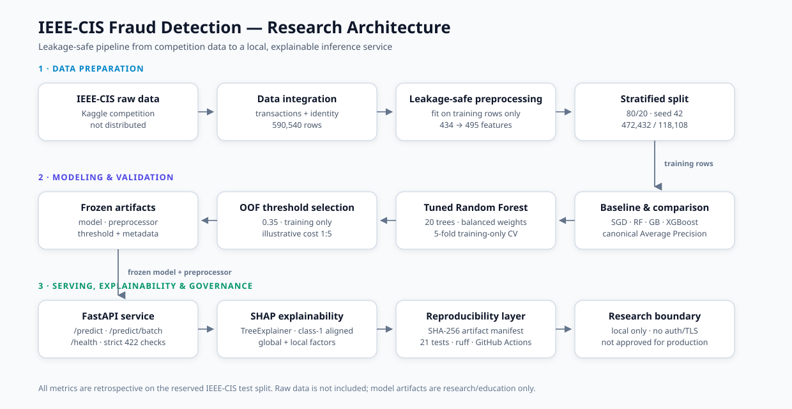
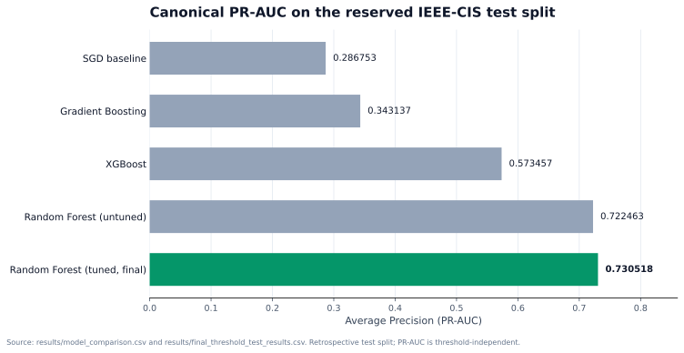
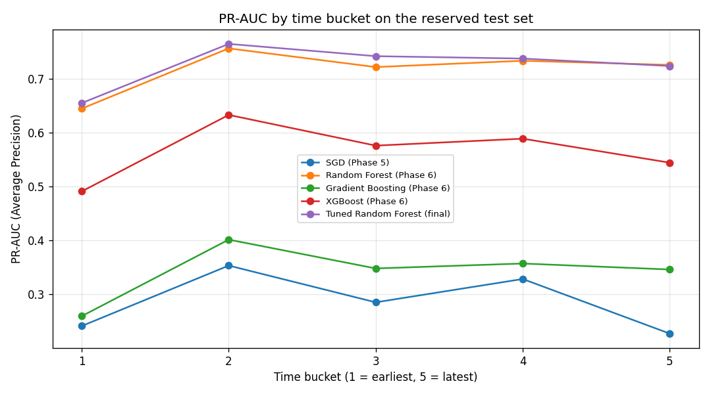
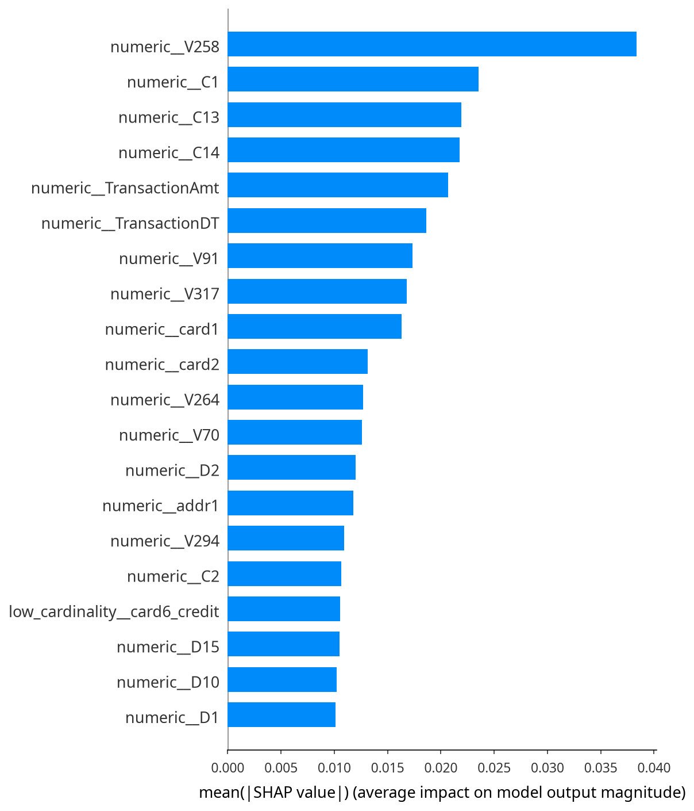
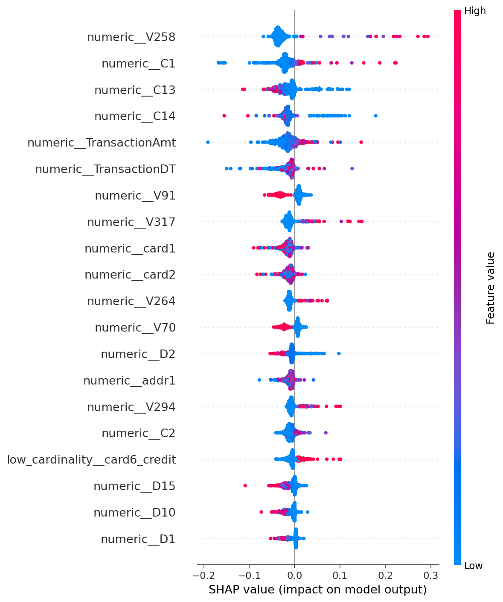

# Fraud Detection System — IEEE-CIS

[](https://github.com/Mmahani/fraud-detection-system/actions/workflows/ci.yml)
[](LICENSE)
[](https://www.python.org/)
[](https://scikit-learn.org/)

**Explainable fraud detection on 590,540 IEEE-CIS transactions — from
leakage-safe preprocessing to a local inference API.**

This is a research project, not a production fraud system. It studies a
rare-event ranking problem end to end: data integration, leakage-safe
preprocessing, model comparison, threshold selection, SHAP explanations, and a
tested FastAPI service.

**At a glance:** 590,540 transactions · 3.4989% fraud · tuned Random Forest ·
**0.730518** test PR-AUC · **0.704887 ± 0.008989** training-only 5-fold PR-AUC.

**Portfolio:** [Case study](docs/CASE_STUDY.md) ·
[Verified results](docs/RESULTS.md) · [LinkedIn/CV copy](docs/PORTFOLIO.md)

> **Status:** research release candidate `v1.0.1`. The code and documentation are
> MIT-licensed. The IEEE-CIS data is **not included**, and the trained model is
> provided for research and education only. The model and API are **not approved
> for production use**. See [Known limitations](#known-limitations) and
> [Data and license](#data-and-license).

---

## Table of contents

- [The problem](#the-problem)
- [The solution](#the-solution)
- [Architecture](#architecture)
- [Verified results](#verified-results)
- [Explainability](#explainability)
- [Tech stack](#tech-stack)
- [Quick start](#quick-start)
- [API at a glance](#api-at-a-glance)
- [Repository map](#repository-map)
- [Documentation](#documentation)
- [Model card](#model-card)
- [Reproducibility](#reproducibility)
- [Testing](#testing)
- [Known limitations](#known-limitations)
- [Security](#security)
- [Data and license](#data-and-license)
- [Release notes](#release-notes)

---

## The problem

Only **3.4989%** of transactions in the IEEE-CIS dataset are fraudulent. A model
can therefore report high accuracy while missing most fraud. The project treats
fraud detection as a **ranking** problem:

- which model ranks fraud highest under severe class imbalance;
- how to preprocess without leaking test information;
- where to place the decision threshold when a false negative is assumed to cost
  more than a false positive;
- how to explain an individual decision to a human reviewer;
- how to make the artifact set reproducible and verifiable.

The answers are documented with their limitations instead of being presented as
production outcomes.

## The solution

An end-to-end, leakage-safe research pipeline:

1. **Integrate** transaction and identity tables into 590,540 rows and 434
   merged columns (432 model inputs plus the identifier and label).
2. **Preprocess** with numeric, low-cardinality, and high-cardinality branches
   fitted on training rows only; 495 transformed features.
3. **Compare** an SGD baseline, Random Forest, Gradient Boosting, and XGBoost
   under one evaluation function.
4. **Tune** a 20-tree balanced Random Forest and validate it with 5-fold
   training-only cross-validation.
5. **Select the threshold** from out-of-fold probabilities and freeze it at
   **0.35** before scoring the test split.
6. **Explain** global and local decisions with SHAP.
7. **Serve** the frozen model through a strictly validated local FastAPI
   service.
8. **Verify** artifacts with a SHA-256 manifest, 21 tests, and GitHub Actions.

## Architecture



[Open the architecture diagram at full size](docs/assets/architecture.svg).

The pipeline is deliberately split into three stages:

| Stage | What happens | Main code |
|---|---|---|
| Data preparation | Integration, leakage-safe preprocessing, stratified split | `notebooks/01`–`04` |
| Modeling and validation | Baselines, comparison, tuning, OOF threshold | `notebooks/05`–`09` |
| Serving and governance | FastAPI, SHAP, manifest, tests, CI | `src/`, `tests/`, `artifacts/` |

Full detail: [`docs/ARCHITECTURE.md`](docs/ARCHITECTURE.md).

## Verified results

Retrospective metrics at the frozen **0.35** threshold on the 118,108-row
reserved test split:

| Metric | Value |
|---|---:|
| Accuracy | 0.972161 |
| Balanced accuracy | 0.852896 |
| Precision | 0.582119 |
| Recall | 0.724655 |
| F1 | 0.645613 |
| ROC-AUC | 0.937292 |
| **PR-AUC (Average Precision)** | **0.730518** |
| TN / FP / FN / TP | 111,825 / 2,150 / 1,138 / 2,995 |

The cleanest generalization estimate is the **5-fold training-only**
cross-validation: PR-AUC **0.704887 ± 0.008989**, F1 **0.666683 ± 0.007884**,
ROC-AUC **0.931818 ± 0.003393**.

| Model comparison (test PR-AUC) | Temporal stability (tuned RF) |
|---|---|
|  |  |

**Left:** Canonical Average Precision from the tracked result files. The untuned
Random Forest reaches 0.722463 and the tuned final model reaches 0.730518;
PR-AUC is threshold-independent.
**Right:** Phase 12 splits the reserved test split into five time buckets.
Buckets 2–5 range from 0.723480 to 0.764482 PR-AUC; the earliest bucket is
0.654729 and also has the lowest fraud rate. This is a stability check, **not** a
strict forward-in-time holdout.

> **Read this before quoting a number:** the test split is retrospective and has
> been reused across phases. Use the training-only 5-fold estimate for
> generalization. Full tables and sources: [`docs/RESULTS.md`](docs/RESULTS.md).

## Explainability

SHAP values were computed for 500 training transactions with
`shap.TreeExplainer`, aligned to the class-1 (Fraud) output. The additivity mean
absolute error is **0.00001165**.

| Global importance | Beeswarm |
|---|---|
|  |  |

| Rank | Feature | Mean absolute SHAP |
|---:|---|---:|
| 1 | `numeric__V258` | 0.038334 |
| 2 | `numeric__C1` | 0.023560 |
| 3 | `numeric__C13` | 0.021904 |
| 4 | `numeric__C14` | 0.021781 |
| 5 | `numeric__TransactionAmt` | 0.020680 |
| 6 | `numeric__TransactionDT` | 0.018603 |

SHAP values describe model associations, not causal effects. The presence of
`TransactionDT` reinforces the temporal-leakage caveat.

## Tech stack

| Layer | Tools |
|---|---|
| Language | Python 3.12 |
| Data | pandas, NumPy, SciPy |
| Modeling | scikit-learn 1.9.0, XGBoost |
| Explainability | SHAP |
| Serving | FastAPI, Uvicorn, Pydantic |
| Visualization | Matplotlib, Seaborn |
| Testing and quality | unittest, ruff, GitHub Actions |
| Reproducibility | SHA-256 artifact manifest, pinned dependencies, LF normalization |

## Quick start

```powershell
git clone https://github.com/Mmahani/fraud-detection-system.git
cd fraud-detection-system

py -m venv .venv
.\.venv\Scripts\Activate.ps1
python -m pip install --upgrade pip
python -m pip install -r requirements.txt
```

Start the API:

```powershell
python -m uvicorn src.api.main:app --host 127.0.0.1 --port 8000
```

In a second terminal, run the demo:

```powershell
python examples/demo_api.py
```

The demo exercises `/health`, `/model/info`, `/model/features`, `/predict`,
`/predict/batch`, and `/explain` using the synthetic payload. See [`docs/DEMO.md`](docs/DEMO.md) for a
manual walkthrough.

The model artifacts require **scikit-learn 1.9.0**; the pinned requirements avoid
the `InconsistentVersionWarning` seen with other versions.

## API at a glance

| Method | Path | Purpose |
|---|---|---|
| `GET` | `/health` | Liveness and model-load status |
| `GET` | `/model/info` | Model type, feature counts, threshold, risk bands |
| `GET` | `/model/features` | Required raw features and derived flags |
| `POST` | `/predict` | Score one transaction |
| `POST` | `/predict/batch` | Score up to 500 transactions |
| `POST` | `/explain` | Score one transaction and return SHAP factors |

Example response for the synthetic payload:

```json
{
  "transaction_id": 990000001,
  "fraud_probability": 0.09821428571428573,
  "classification_threshold": 0.35,
  "prediction": "Legitimate",
  "risk_level": "Low"
}
```

[`examples/sample_transaction.json`](examples/sample_transaction.json) is fully
synthetic. It has 433 fields: 432 model inputs plus `TransactionID`. The service
derives the two `*_is_missing` flags, which brings the model input to 434
features.

The service is intentionally local: no authentication, rate limiting, or TLS.
Do not expose it directly to the public internet. See
[`docs/DEMO.md`](docs/DEMO.md) and [`SECURITY.md`](SECURITY.md).

## Repository map

```text
fraud-detection-system/
├── data/                     # raw/ and processed/ are not tracked
├── models/                   # frozen inference artifacts + README
├── notebooks/                # phased research notebooks + README
├── artifacts/
│   └── manifest.json         # 40-entry SHA-256 artifact inventory
├── results/                  # metrics, reports, plots + README
├── examples/
│   ├── sample_transaction.json   # synthetic 433-field payload
│   ├── demo_api.py               # local API demo client
│   └── README.md
├── docs/
│   ├── assets/
│   │   ├── architecture.svg
│   │   ├── model_comparison_pr_auc.svg
│   │   └── model_comparison_pr_auc.png
│   ├── ARCHITECTURE.md
│   ├── RESULTS.md
│   ├── DEMO.md
│   ├── CASE_STUDY.md
│   ├── PORTFOLIO.md
│   └── README.md
├── scripts/
│   ├── audit_metrics.py
│   ├── plot_model_comparison.py
│   └── time_based_validation.py
├── src/
│   ├── prediction.py
│   ├── api/
│   │   ├── main.py
│   │   └── schemas.py
│   └── fraud/
│       ├── metrics.py
│       └── artifacts.py
├── tests/
├── .github/workflows/ci.yml
├── .gitattributes
├── DATA_LICENSE.md
├── LICENSE
├── MODEL_CARD.md
├── README.md
├── RELEASE_NOTES.md
├── SECURITY.md
├── requirements.txt
└── requirements-ci.txt
```

Text files use LF line endings via `.gitattributes`, so the SHA-256 hashes in
[`artifacts/manifest.json`](artifacts/manifest.json) are stable across checkout
platforms.

Only the final inference artifacts are tracked:

- `models/best_tuned_model.pkl`
- `models/preprocessor.pkl`
- `models/threshold_config.json`
- `models/model_metadata.json`
- `models/explainability_config.json`

`models/random_forest.pkl` (~157 MB) and the processed matrices are intentionally
ignored.

## Documentation

| Document | Contents |
|---|---|
| [`docs/ARCHITECTURE.md`](docs/ARCHITECTURE.md) | Data flow, components, leakage controls, serving path |
| [`docs/RESULTS.md`](docs/RESULTS.md) | Verified metrics, plots, threshold behaviour, SHAP |
| [`docs/DEMO.md`](docs/DEMO.md) | Step-by-step API walkthrough |
| [`docs/CASE_STUDY.md`](docs/CASE_STUDY.md) | Problem, role, decisions, challenges, results |
| [`docs/PORTFOLIO.md`](docs/PORTFOLIO.md) | LinkedIn and CV descriptions |
| [`MODEL_CARD.md`](MODEL_CARD.md) | Intended use, metrics, ethics, limitations |
| [`docs/README.md`](docs/README.md) | Documentation index and reading order |

Folder-level guides: [`examples/README.md`](examples/README.md),
[`notebooks/README.md`](notebooks/README.md),
[`results/README.md`](results/README.md), [`models/README.md`](models/README.md).

## Model card

| Property | Value |
|---|---|
| Algorithm | `RandomForestClassifier` |
| Estimators | 20 |
| `max_depth` | `None` |
| `min_samples_leaf` | 2 |
| `min_samples_split` | 5 |
| `max_features` | 0.5 |
| `class_weight` | `balanced` |
| Raw input features | 434 |
| Transformed features | 495 |
| Classification threshold | **0.35** |
| Risk bands | Low `<0.30`, Medium `0.30–0.70`, High `≥0.70` |

The threshold was selected from out-of-fold training probabilities using an
illustrative `COST_FP=1` / `COST_FN=5` rule, with F1 as a tie-breaker. These costs
are not verified business costs. Risk bands are presentation labels, not the
classification threshold.

See [`MODEL_CARD.md`](MODEL_CARD.md) for intended use and ethical considerations.

## Reproducibility

- Raw and processed data are excluded from Git. Regenerate them with notebooks
  01–04 after obtaining the data from Kaggle.
- The final model is tracked; large comparison models are not.
- The preprocessor must be loaded through `src.prediction`.
- Random seeds are fixed at `42` where applicable.
- The model was serialized with scikit-learn 1.9.0.
- The test metrics are retrospective, not a pristine final holdout.
- `python -m src.fraud.artifacts validate` checks the tracked artifacts.

The Phase 6 metric outputs were refreshed from saved test probabilities because a
full retrain exceeded the 8 GB environment. Training times and feature
importances remain from the historical run; see
[`results/phase8_evaluation_audit.md`](results/phase8_evaluation_audit.md).

## Testing

```powershell
python -m unittest discover -s tests -v
python -m ruff check src scripts tests examples
python -m src.fraud.artifacts validate
```

The suite covers canonical metrics, input validation, manifest generation and
validation, and the REST API (health, model info, single and batch prediction,
validation errors, and SHAP explanation). GitHub Actions runs lint and tests on
pushes and pull requests to `main`. On a clean clone without `data/processed/`,
one data-dependent test is skipped and the other 20 run.

## Known limitations

- Notebooks 05 and 10 were re-executed end to end after the path and metric
  changes. The Phase 6 metric outputs were refreshed from saved test
  probabilities, but its training-time and feature-importance outputs remain from
  the historical run. The other notebooks have not been re-executed end to end.
- A full Phase 6 training rerun is still pending because the 8 GB environment
  cannot complete it reliably. The saved probability arrays let the reported
  metrics be regenerated without retraining.
- The model shows a large train/test gap at the default 0.5 threshold (train F1
  0.9569 vs test F1 0.6913), so overfitting remains a concern.
- The split is random and stratified, not time-based. `TransactionDT` is among
  the strongest SHAP features, so temporal leakage is possible. Phase 12 checks
  temporal stability on the reserved holdout but cannot replace a strict
  forward-in-time retrain.
- The test set has been reused across phases and is not a pristine holdout.
- Probabilities are not calibrated; risk bands are heuristic.
- CI runs lint and unit tests, but there is no deployment pipeline or container
  image. The API has no authentication, rate limiting, or TLS and should run
  behind a gateway in production.
- `models/xgboost.pkl` requires the optional `xgboost` package.

## Security

The FastAPI service is a local research service. It has no authentication, rate
limiting, or TLS. Do not expose it directly to the public internet. Report
vulnerabilities through GitHub's private vulnerability reporting as described in
[`SECURITY.md`](SECURITY.md).

## Data and license

### Code license

The source code and documentation are licensed under the **MIT License**. See
[`LICENSE`](LICENSE). Copyright (c) 2026 Mohammed M. A. Mahani.

### IEEE-CIS dataset

The dataset is the IEEE-CIS Fraud Detection competition data, sponsored by the
IEEE Computational Intelligence Society and donated by Vesta Corporation, hosted
by Kaggle. It is **not included** in this repository. The competition rules
allow non-commercial use only (competition participation, Kaggle forums, academic
research, and education) and prohibit transmitting, duplicating, publishing, or
redistributing the data to any party not participating in the competition.
Obtain the data from Kaggle and accept the rules before use.

See [`DATA_LICENSE.md`](DATA_LICENSE.md) for the full notice.

### Model artifacts

The trained model and preprocessor were fitted on the IEEE-CIS data. They are
provided for research and education only, "as is", and are not a redistribution
of the dataset. The MIT License covers the source code and documentation; it does
not grant rights to the dataset. Commercial or production use requires
independent legal review and any permission required from the rights holders.

## Release notes

The release notes are documented in [RELEASE_NOTES.md](RELEASE_NOTES.md).
`v1.0.0` records the private delivery snapshot; `v1.0.1` is the prepared research
release. See the notes for verification results, headline metrics, deliverables,
the handoff checklist, and known limitations.
