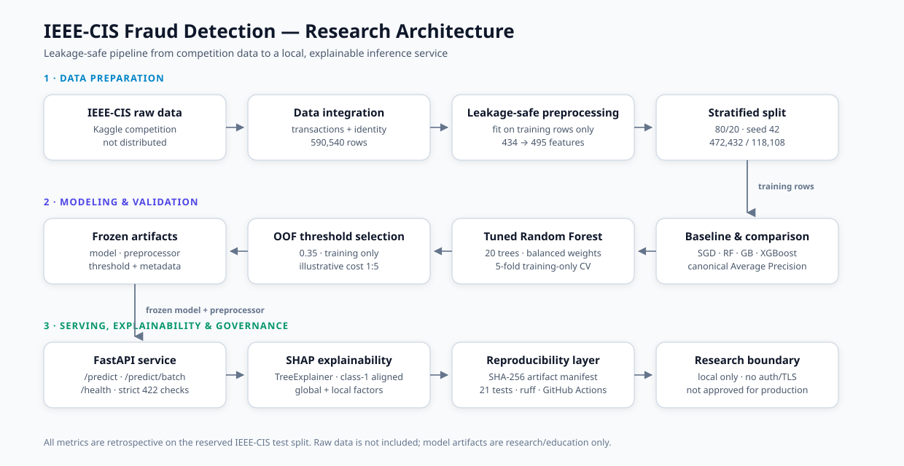

# Architecture

This document describes how the repository moves from raw IEEE-CIS competition
files to a frozen, explainable inference service. It is a research pipeline, not
a production deployment.



## 1. Design goals

| Goal | How the repository addresses it |
|---|---|
| Avoid preprocessing leakage | Preprocessing is fitted on training rows only, before the test split is scored |
| Make the comparison fair | All models use the same split, the same canonical Average Precision definition, and the same evaluation code |
| Keep decisions traceable | Threshold selection uses out-of-fold training probabilities; the test split is not used to choose the threshold |
| Make artifacts verifiable | `artifacts/manifest.json` records sizes and SHA-256 hashes for the frozen artifacts |
| Explain individual decisions | SHAP `TreeExplainer` values are aligned to the class-1 (Fraud) output |
| Keep the service honest | The API is local-only, strictly validated, and explicitly not for production |

## 2. Stage 1 — Data preparation

1. **Raw input**
   - `data/raw/train_transaction.csv` (~651 MB)
   - `data/raw/train_identity.csv` (~25 MB)
   - Both are obtained from Kaggle after accepting the competition rules and
     are **never committed** to Git.
2. **Integration** (`notebooks/02_data_integration.ipynb`)
   - Join transaction and identity tables on `TransactionID`.
   - Result: 590,540 rows and 434 merged columns (432 model inputs plus the
     identifier and label).
3. **Leakage-safe preprocessing** (`notebooks/04_preprocessing.ipynb`)
   - Numeric, low-cardinality, and high-cardinality branches are fitted on the
     training partition only.
   - Two missingness flags (`DeviceInfo_is_missing`, `id_33_is_missing`) are
     derived from raw fields.
   - Result: 495 transformed features.
4. **Split**
   - Stratified random 80/20 split with `random_state=42`.
   - 472,432 training rows and 118,108 test rows.
   - Known limitation: the split is not time-based.

## 3. Stage 2 — Modeling and validation

1. **Baseline and comparison**
   - SGD baseline, untuned Random Forest, Gradient Boosting, and XGBoost.
   - Primary metric: Average Precision (`sklearn.average_precision_score`),
     labelled PR-AUC in the repository.
2. **Tuning** (`notebooks/08_imbalance_and_tuning.ipynb`)
   - Selected configuration: `RandomForestClassifier` with 20 estimators,
     `min_samples_leaf=2`, `min_samples_split=5`, `max_features=0.5`,
     `max_depth=None`, and `class_weight="balanced"`.
   - Validated with 5-fold `StratifiedKFold` on training rows only.
3. **Threshold selection** (`notebooks/09_threshold_optimization.ipynb`)
   - 5-fold out-of-fold probabilities from the training partition.
   - Frozen threshold: **0.35**, chosen with an illustrative
     `COST_FP=1` / `COST_FN=5` rule and F1 as a tie-breaker.
   - The costs are **not** claimed to be real business costs.
4. **Frozen artifacts**
   - `models/best_tuned_model.pkl`
   - `models/preprocessor.pkl`
   - `models/threshold_config.json`
   - `models/model_metadata.json`
   - `models/explainability_config.json`

## 4. Stage 3 — Serving and explainability

```text
raw transaction (JSON)
        │
        ▼
schema check ──► 422 on missing or unexpected fields
        │
        ▼
src.prediction._transform
  ├─ derive missingness flags
  ├─ load cached preprocessor
  └─ produce 495 transformed features
        │
        ▼
RandomForestClassifier.predict_proba[:, 1]
        │
        ├─► fraud probability
        ├─► risk band (presentation only)
        └─► compare with frozen 0.35 threshold
                    │
                    ▼
             Fraud / Legitimate

/explain only:
  shap.TreeExplainer → class-1 SHAP values → top positive/negative factors
```

### Service endpoints

| Endpoint | Role |
|---|---|
| `GET /` | Service name and version |
| `GET /health` | Liveness and model-load status |
| `GET /model/info` | Model type, feature counts, threshold, risk bands |
| `GET /model/features` | Required raw features and derived fields |
| `POST /predict` | Score one transaction |
| `POST /predict/batch` | Score up to 500 transactions |
| `POST /explain` | Score one transaction and return SHAP factors |

The API has **no authentication, rate limiting, or TLS**. It binds to
`127.0.0.1` in the documented commands and must not be exposed directly to the
public internet.

## 5. Reproducibility and governance layer

| Control | Implementation |
|---|---|
| Artifact inventory | `artifacts/manifest.json` with 40 entries (25 required, 15 optional) |
| Hash stability | `.gitattributes` forces LF line endings; hashes are stable across checkout platforms |
| Tests | 21 `unittest` tests covering metrics, manifest behaviour, and the API; on a clean clone one data-dependent test is skipped and 20 run |
| Lint | `ruff check src scripts tests examples` |
| CI | `.github/workflows/ci.yml` installs `requirements-ci.txt`, runs lint and tests |
| Release history | `RELEASE_NOTES.md` records `v1.0.0` and the prepared `v1.0.1` |
| Data rights | `DATA_LICENSE.md` documents IEEE-CIS terms and model limits |

## 6. What is intentionally out of scope

- A strict forward-in-time retrain.
- Probability calibration.
- Authentication, authorization, rate limiting, or TLS.
- Containerization and a deployment pipeline.
- Drift monitoring, alerting, and human-in-the-loop review.
- Any claim of production readiness or business impact.

## 7. Related documents

- [Results](RESULTS.md)
- [API demo](DEMO.md)
- [Model card](../MODEL_CARD.md)
- [Repository README](../README.md)
