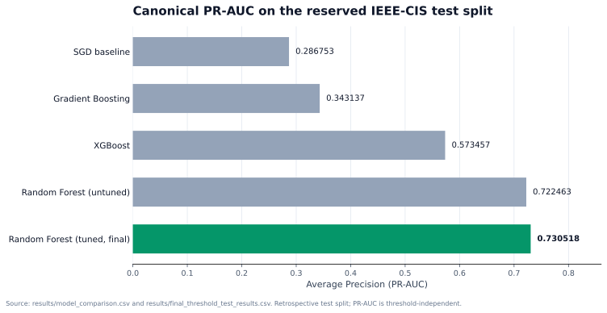
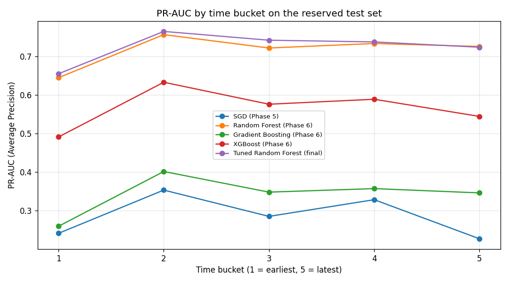
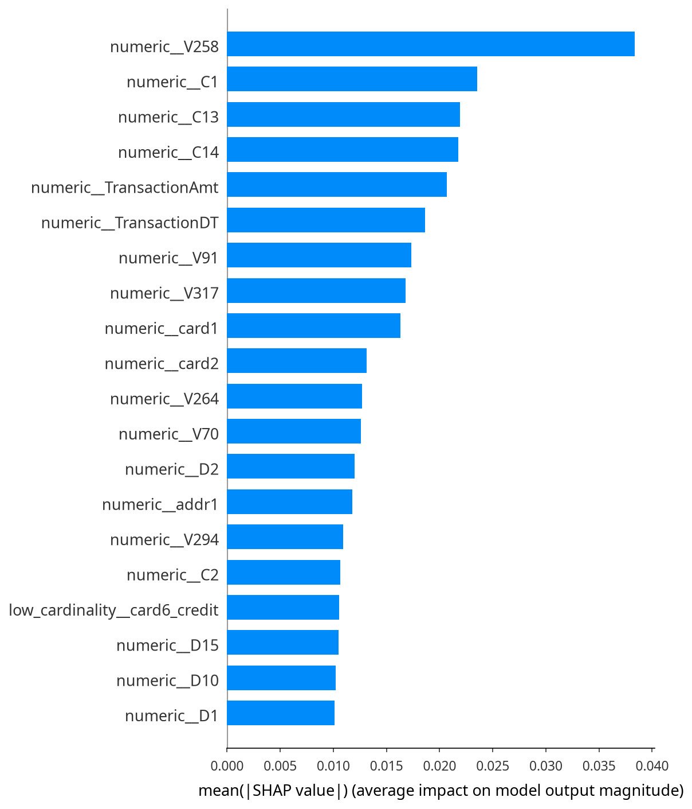
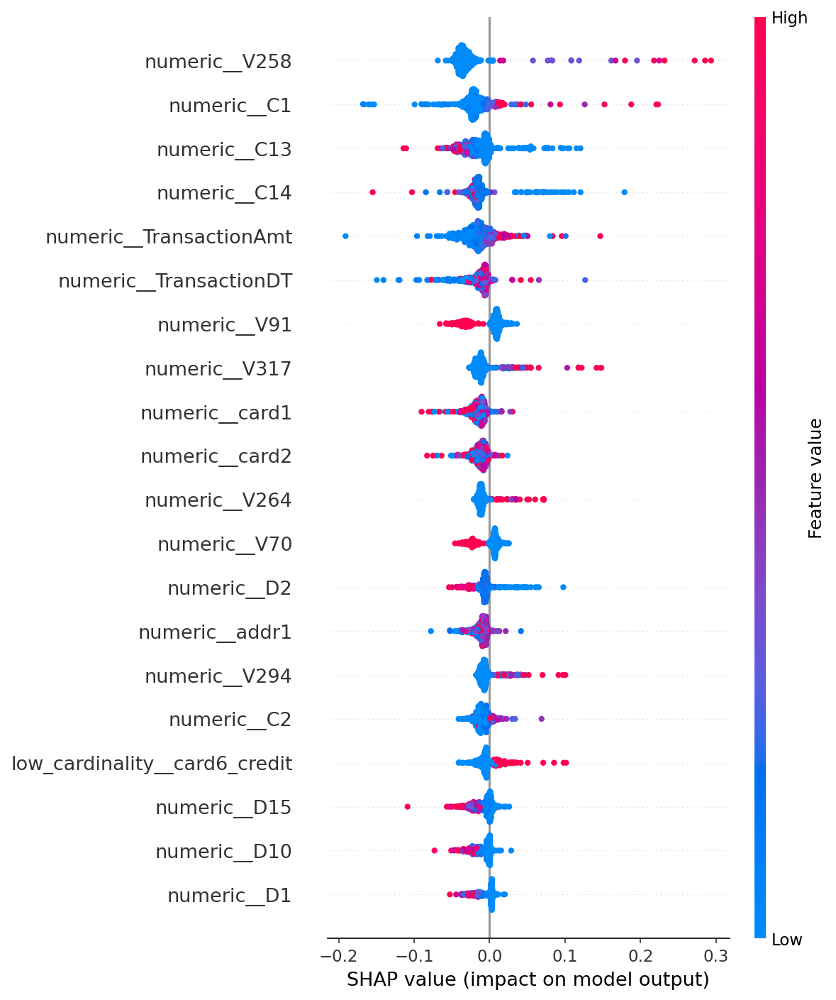

# Results

All numbers on this page come from tracked artifacts in the repository. They are
**retrospective** measurements on a reserved IEEE-CIS test split that has been
reused across phases. They are not a pristine final holdout and do not imply
production performance.

## 1. Evaluation protocol

| Item | Value |
|---|---|
| Dataset | IEEE-CIS Fraud Detection (Kaggle / Vesta Corporation) |
| Rows | 590,540 |
| Fraud rate | 3.4989% |
| Split | Stratified random 80/20, `random_state=42` |
| Training rows | 472,432 |
| Test rows | 118,108 |
| Model input features | 434 (432 raw + 2 derived) |
| Transformed features | 495 |
| Primary metric | Average Precision (labelled PR-AUC) |

PR-AUC in this repository means `sklearn.metrics.average_precision_score`, not
the trapezoidal `auc(recall, precision)` variant. See
[`results/metrics_definition_audit.md`](../results/metrics_definition_audit.md).

## 2. Frozen operating point (threshold 0.35)

Source: [`results/final_threshold_test_results.csv`](../results/final_threshold_test_results.csv)

| Metric | Value |
|---|---:|
| Accuracy | 0.972161 |
| Balanced accuracy | 0.852896 |
| Precision | 0.582119 |
| Recall | 0.724655 |
| F1 | 0.645613 |
| ROC-AUC | 0.937292 |
| PR-AUC (Average Precision) | **0.730518** |
| TN | 111,825 |
| FP | 2,150 |
| FN | 1,138 |
| TP | 2,995 |

The threshold was frozen from out-of-fold training probabilities before the test
split was scored. `COST_FP=1` and `COST_FN=5` are illustrative, not verified
business costs.

### Comparison at threshold 0.50

Source: [`results/threshold_050_vs_final_test.csv`](../results/threshold_050_vs_final_test.csv).
The threshold-selection procedure is documented in
[`results/phase9_final_report.md`](../results/phase9_final_report.md).

| Metric | Threshold 0.50 | Threshold 0.35 |
|---|---:|---:|
| Precision | 0.757558 | 0.582119 |
| Recall | 0.636584 | 0.724655 |
| F1 | 0.691822 | 0.645613 |
| FP | 842 | 2,150 |
| FN | 1,502 | 1,138 |

Moving from 0.50 to 0.35 trades precision for recall and reduces false negatives
at the cost of more false positives. That is an operating-point decision, not a
model improvement.

> **Note on two 0.50 artifacts:** the values above come from
> `results/threshold_050_vs_final_test.csv`. The Phase 8 recomputation reports
> marginally different 0.50 counts (FP 835 / FN 1,509) in
> [`results/phase8_fast_report.md`](../results/phase8_fast_report.md). The frozen
> 0.35 results in
> `final_threshold_test_results.csv` and `threshold_050_vs_final_test.csv` are
> identical. See [`results/phase8_evaluation_audit.md`](../results/phase8_evaluation_audit.md).

## 3. Training-only validation

Five-fold `StratifiedKFold` on the training partition only. The test split was
not used.

Source: [`results/phase8_fast_summary.json`](../results/phase8_fast_summary.json)

| Metric | Mean | Std (ddof=1) |
|---|---:|---:|
| PR-AUC | 0.704887 | 0.008989 |
| F1 | 0.666683 | 0.007884 |
| Recall | 0.608227 | 0.010642 |
| Precision | 0.737667 | 0.007506 |
| ROC-AUC | 0.931818 | 0.003393 |

This is the cleanest generalization estimate in the repository. The test-set
PR-AUC is slightly higher (0.730518), but the test split has been reused.

## 4. Model comparison

Canonical Average Precision on the same test split, each model at its own
default prediction threshold.

Source: [`results/model_comparison.csv`](../results/model_comparison.csv)

| Model | PR-AUC | F1 | ROC-AUC |
|---|---:|---:|---:|
| Random Forest (untuned) | 0.722463 | 0.663877 | 0.940513 |
| XGBoost | 0.573457 | 0.306512 | 0.909753 |
| Gradient Boosting | 0.343137 | 0.221847 | 0.789104 |
| SGD baseline | 0.286753 | 0.328110 | 0.860654 |

The tuned Random Forest reaches PR-AUC **0.730518**; PR-AUC is
threshold-independent, so the frozen 0.35 operating point does not change this
value. The chart is generated by `scripts/plot_model_comparison.py` from
`results/model_comparison.csv` and `results/final_threshold_test_results.csv`.

> The archived plot `results/phase8_plots/model_pr_auc_comparison.png` displays
> the older **trapezoidal** PR-AUC values (0.7311, 0.3693). It is retained for
> audit only and must not be compared with the canonical Average Precision
> values above. See
> [`results/metrics_definition_audit.md`](../results/metrics_definition_audit.md).

## 5. Temporal stability diagnostic

Phase 12 sorts the reserved test split by `TransactionDT` into five equal-count
buckets.

Source: [`results/phase12_time_validation.csv`](../results/phase12_time_validation.csv)

| Bucket | Tuned RF PR-AUC | Fraud rate |
|---|---:|---:|
| 1 (earliest) | 0.654729 | 2.41% |
| 2 | 0.764482 | 3.99% |
| 3 | 0.741715 | 3.73% |
| 4 | 0.737265 | 3.97% |
| 5 (latest) | 0.723480 | 3.40% |

Buckets 2–5 range from 0.723480 to 0.764482 PR-AUC. The earliest bucket is lower
(0.654729) and also has the lowest fraud rate; PR-AUC is prevalence-sensitive, so
part of that gap is compositional. Because the split is random, every bucket overlaps
the training period. **This is not a strict forward-in-time holdout.**

## 6. Explainability

SHAP was computed for a reproducible sample of 500 training transactions
(`random_state=42`) with `shap.TreeExplainer`. No retraining, tuning, or threshold
changes were performed.

Source: [`results/phase10_final_report.md`](../results/phase10_final_report.md)

| Check | Value |
|---|---:|
| Sample size | 500 |
| Transformed features | 495 |
| Class-1 additivity MAE | 0.00001165 |

Top global features by mean absolute SHAP value:

| Rank | Feature | Mean absolute SHAP |
|---:|---|---:|
| 1 | `numeric__V258` | 0.038334 |
| 2 | `numeric__C1` | 0.023560 |
| 3 | `numeric__C13` | 0.021904 |
| 4 | `numeric__C14` | 0.021781 |
| 5 | `numeric__TransactionAmt` | 0.020680 |
| 6 | `numeric__TransactionDT` | 0.018603 |

SHAP values describe model associations, not causal effects. `TransactionDT`
appearing among the strongest features reinforces the temporal-leakage caveat.

## 7. Overfitting diagnostic

Both columns use the default 0.5 prediction threshold, so they are directly
comparable.

Source: [`MODEL_CARD.md`](../MODEL_CARD.md)

| Metric | Training (0.5) | Test (0.5) |
|---|---:|---:|
| Accuracy | 0.996850 | 0.980154 |
| Balanced accuracy | 0.998368 | 0.813782 |
| Precision | 0.917416 | 0.758601 |
| Recall | 1.000000 | 0.634890 |
| F1 | 0.956929 | 0.691254 |
| ROC-AUC | 0.999998 | 0.937292 |
| PR-AUC | 0.999923 | 0.730518 |

The train/test F1 gap of about **0.2657** is a large overfitting diagnostic, not
an unbiased generalization estimate.

> These Phase 8 recomputation values differ marginally from the 0.50 row in
> [`threshold_050_vs_final_test.csv`](../results/threshold_050_vs_final_test.csv);
> see the note in section 2. The frozen 0.35 results are unaffected.

## 8. Artifact sources

| Result | Source file |
|---|---|
| Frozen-threshold metrics | `results/final_threshold_test_results.csv` |
| Threshold comparison | `results/threshold_050_vs_final_test.csv` |
| Threshold selection | `results/phase9_final_report.md` |
| Training-only CV | `results/phase8_fast_summary.json` |
| Model comparison | `results/model_comparison.csv` |
| Canonical comparison chart | `results/model_comparison.csv` + `results/final_threshold_test_results.csv`, rendered by `scripts/plot_model_comparison.py` |
| Temporal diagnostic | `results/phase12_summary.json`, `results/phase12_time_validation.csv` |
| SHAP report | `results/phase10_final_report.md` |
| SHAP global ranking | `results/shap_global_importance.csv` |
| SHAP local examples | `results/shap_local_explanations.csv` |
| Metric-definition audit | `results/metrics_definition_audit.md` |
| Evaluation audit | `results/phase8_evaluation_audit.md` |

## 9. How to read these results

- Use the **training-only 5-fold CV** as the main generalization estimate.
- Treat the test-set numbers as **retrospective** because the test split was
  reused across phases.
- Do not compare the tuned model's 0.35 threshold with another model's default
  threshold as if they were the same operating point.
- Do not interpret SHAP values as causal.
- Do not treat the illustrative 1:5 cost ratio as a business fact.
